# G2 Study

**Lecture to flashcards on Even Realities G2 smart glasses, with review rounds sized to your train ride.**

G2 Study is an [Even Hub](https://hub.evenrealities.com/docs/get-started/overview) plugin. It listens to a lecture through the glasses microphones, turns the transcript into short flashcards with an LLM, and lets you review them on the glasses with the temple touchpad or R1 ring. On the way home it looks up your train and plans a round that ends two minutes before you arrive.

[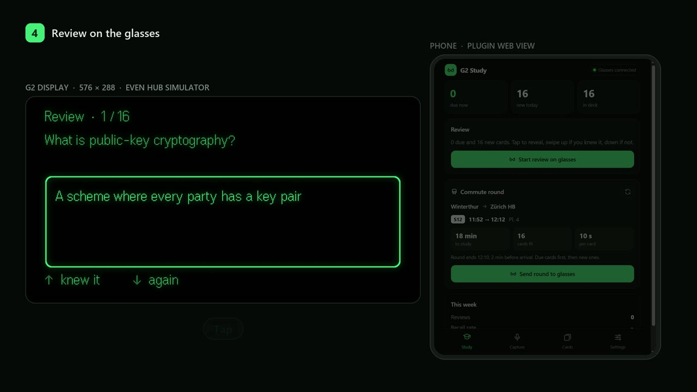](docs/media/g2-study-demo.mp4)

**[Watch the demo (1:49)](docs/media/g2-study-demo.mp4)**, recorded in the official simulator.

> **Status: tested in the Even Hub simulator only.** I do not have G2 hardware yet. Everything below was run in `evenhub-simulator` 0.9.5 against SDK 0.0.16; real-device behaviour (Bluetooth timing, long recordings with the phone locked) is untested. See [Open risks](#open-risks).

## What it does

**1. Lecture to cards**

- **Record** from the glasses: long-press the temple or ring to start, again to stop. The glasses show a running timer and the last transcribed sentence.
- Audio is cut into ~60 s pieces at natural pauses, **stored on the phone first**, then sent to a Whisper-compatible endpoint. Failed uploads retry with backoff; nothing is lost if the connection drops.
- When you stop, an LLM turns the transcript into cards (`front` ≤ 60 chars, `back` ≤ 120 chars, plus a source quote), in chunks, with near-duplicates removed.
- On the phone you **check every card** (edit, delete, keep) before it enters the deck. Character counters show what fits the display.
- **No live audio?** Paste a transcript, notes or text copied from the lecture PDF, or upload an audio or subtitle file. Same pipeline.

**2. Review on the glasses**

- Scheduling with [FSRS](https://github.com/open-spaced-repetition/ts-fsrs). Overdue cards first (most overdue relative to their interval), then new cards up to a daily limit.
- Tap to reveal, **swipe up = knew it** (FSRS *Good*), **swipe down = again** (*Again*, and the card comes back later in the round).

**3. Commute rounds**

- Looks up the next connection on [transport.opendata.ch](https://transport.opendata.ch) (free, no key), default Winterthur → Zürich HB.
- Budget = departure (or now, if already on board) until arrival minus 2 min. Card count = budget ÷ *your* median seconds per card, learned from your reviews.
- The round **stops itself** before a card that would not finish in time, even if you stop touching the glasses, and shows an arrival summary.

| Home | Card front | Card back |
|---|---|---|
| 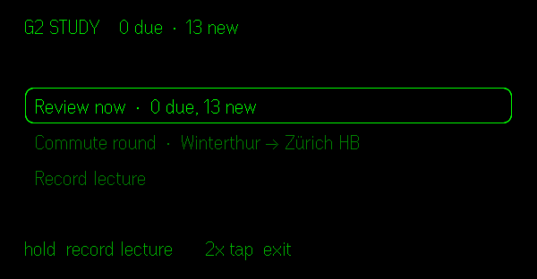 | 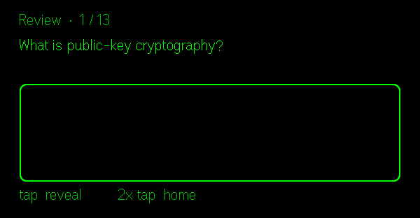 | 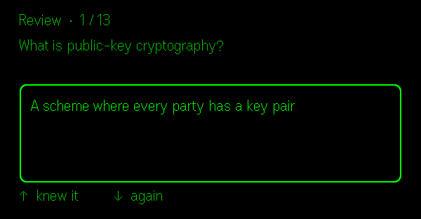 |
| **Commute offer** (live timetable) | **Commute round** | **Stops before arrival** |
| 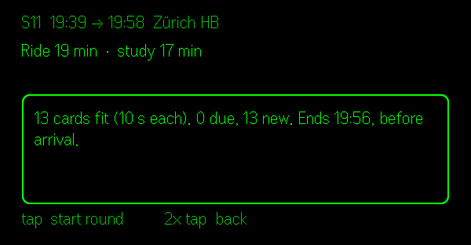 | 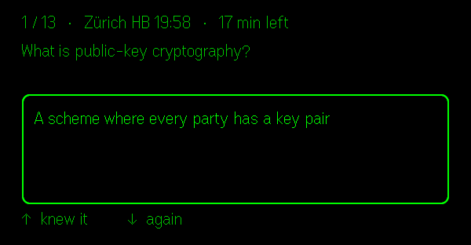 | 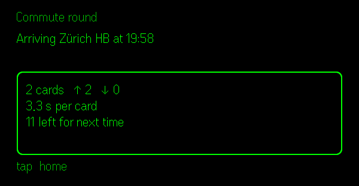 |
| **Recording**\* | **Lecture saved** | **Round summary** |
| 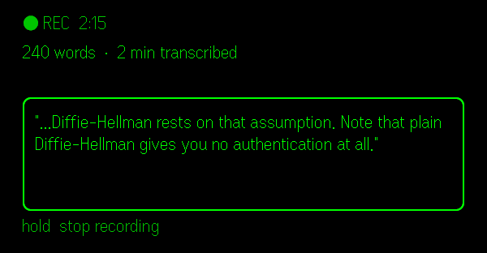 | 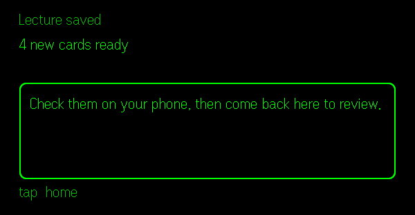 | 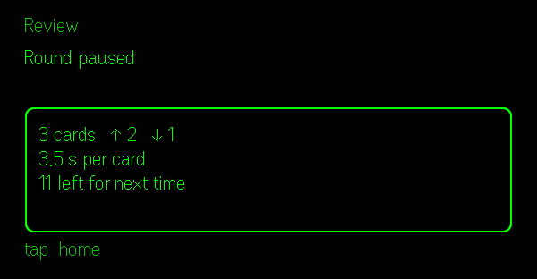 |

\* The recording screenshot used the simulator's real microphone stream, but the text came from [`scripts/mock-whisper.mjs`](scripts/mock-whisper.mjs), a plumbing test server that replays the sample lecture. Point Settings at OpenAI or your own Whisper server for real transcription.

The phone side (the plugin's web view inside the Even Realities app):

| Study | Capture | Check cards | Settings |
|---|---|---|---|
| 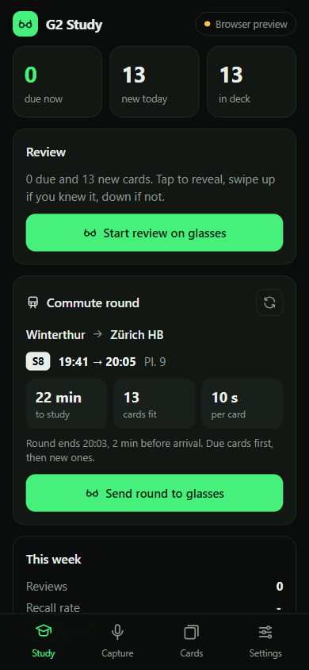 | 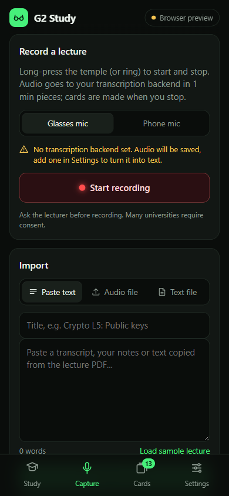 | 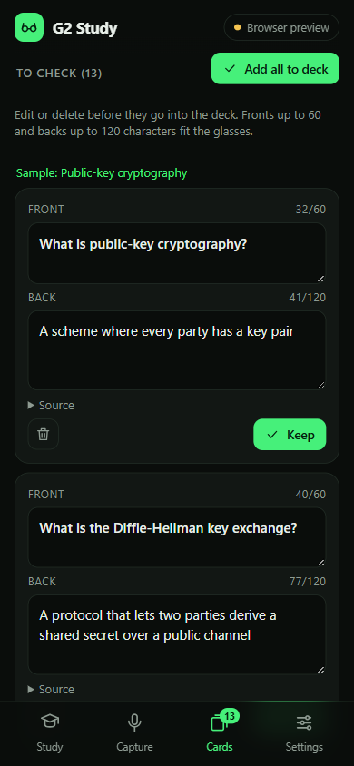 | 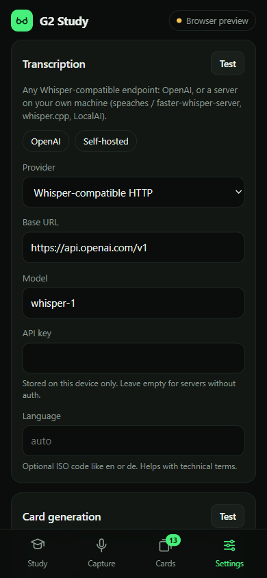 |

## Gestures

Same on the temple touchpads and the R1 ring.

| Gesture | Home | Card front | Card back | Recording |
|---|---|---|---|---|
| Tap | open selected item | reveal | – | – |
| Swipe up / down | move selection | – | knew it / again | – |
| Double tap | exit (system dialog) | end round | end round | back to home (keeps recording) |
| Long press | start recording | – | – | stop recording |

Every action also has a phone button, since the docs call long press "an enhancement, not the only path". The glasses context menu offers Home / Review / Commute / Record.

## Quick start (simulator, no API keys)

Requires Node 20.17+.

```bash
npm install
npm run dev          # Vite on http://localhost:5173
npm run sim          # official Even Hub simulator pointed at the dev server
```

By default cards come from a small **offline rule-based extractor** (definition sentences like "X is ..."), so the whole flow works without any key. It is much weaker than an LLM; switch to a model in Settings.

Demo shortcuts (dev server only; packaged builds ignore URL parameters):

| URL parameter | Effect |
|---|---|
| `?seed=sample` | fill an empty deck with cards from [`samples/public-key-crypto.txt`](samples/public-key-crypto.txt) |
| `?profile=take3` | use a separate deck, e.g. a fresh one per video take |
| `?timescale=60` | commute rounds run on a 60x clock, so a 20 min ride ends in ~20 s |
| `?whisper=http://host:port/v1` | use a Whisper server without auth for this session |

```bash
node node_modules/@evenrealities/evenhub-simulator/bin/index.js "http://localhost:5173/?seed=sample&profile=demo1&timescale=60"
```

Opening `http://localhost:5173` in a normal browser also works: the page draws its own glasses preview (keys: ↑ ↓, Enter = tap, Esc = double tap, hold H = long press) and uses the browser microphone. The official simulator is the accurate one.

## Backends

Both are configured in the app (Settings) and stored only on the device.

**Transcription**: any server that implements OpenAI's `POST /v1/audio/transcriptions`:

| Backend | Base URL | Model |
|---|---|---|
| OpenAI | `https://api.openai.com/v1` | `whisper-1` (or `gpt-4o-mini-transcribe`) |
| [speaches](https://github.com/speaches-ai/speaches) / faster-whisper-server on a home server | `http://<host>:8000/v1` | e.g. `Systran/faster-whisper-small` |
| whisper.cpp server, LocalAI | their OpenAI-compatible URL | – |

Each chunk is sent as 16 kHz mono WAV with the previous text as `prompt`, so technical terms stay consistent across chunks.

**Cards**: any OpenAI-compatible chat endpoint (OpenAI, Ollama `http://localhost:11434/v1`, llama.cpp, vLLM, LM Studio, OpenRouter). The prompt asks for strict JSON `{"cards":[{front, back, source_snippet}]}`; the parser also accepts bare arrays and fenced output, and retries without `response_format` for servers that reject it.

Self-hosted servers must send CORS headers, since the plugin is a web page: for Ollama set `OLLAMA_ORIGINS=*`; for speaches/faster-whisper-server enable CORS in its config.

**Keys and secrets**: never in the repo. For local development you may put defaults in `.env.local` (see [`.env.example`](.env.example)), but Vite bakes `VITE_*` values into the bundle, so `npm run build` **refuses to run** while a `*_KEY` variable is set.

## Run on a phone / package

```bash
npm run qr      # QR code for sideloading the dev server into the Even Realities app (same Wi-Fi)
npm run pack    # build + evenhub pack -> g2-study.ehpk
```

Network access from a packaged plugin is limited to the origins in [`app.json`](app.json) (`permissions[].whitelist`). It lists `https://api.openai.com` and `https://transport.opendata.ch`; **add your home server's origin there** before packing if you self-host. `package_id` is a placeholder (`io.github.gstudy`); change it to your own reverse domain before submitting.

## How it works

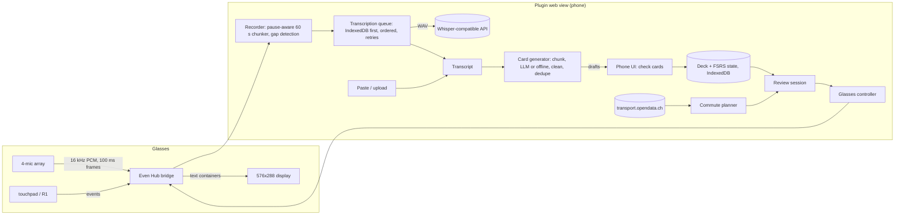

Design notes from testing in the simulator:

- **Two screen layouts only.** Every non-home screen uses the same four text containers (header, question, bordered answer box, footer), so revealing an answer or moving to the next card is an in-place `textContainerUpgrade`, not a page rebuild: no flicker, minimal Bluetooth traffic. The question stays visible (dimmed) above the answer.
- **Measured font**: proportional, ~29 px line height, about 10 lines × 50 characters per screen. Text is fitted with an estimated-width word wrap so nothing overflows (an overflowing text container scrolls on swipe, which would eat the grading gesture).
- **Glyphs checked in the simulator font**: umlauts, `→ ↑ ↓ ▲ ▼ ● ○` render; `✓ ✗` do not. Generated cards are normalised (curly quotes, dashes, ellipsis) before display.
- **Event shapes as observed** (documented in [`src/glasses/input.ts`](src/glasses/input.ts)): a tap on a text page arrives as `sysEvent` with no `eventType` (protobuf drops 0 = CLICK), swipes as `textEvent` 1/2, double tap 3, long press 9/10; list taps carry `currentSelectItemIndex`.

## Open risks

| Risk | What the docs say | What the code does | How I will test it on hardware |
|---|---|---|---|
| Mic for 60–90 min, phone locked | Audio capture "stops if the WebView is suspended"; iOS keeps the WebView running, Android may suspend it under memory pressure. Duration limits are not documented. | Detects gaps (no frames for 3 s), warns on glasses and phone, re-opens the mic on foreground, keeps every chunk on disk, and stores per-lecture diagnostics (frames, gaps, seconds lost). | 90 min soak tests on iOS and Android: screen on / locked / app switched, then read the gap log in the lecture details. |
| Battery and Bluetooth load | Not documented. | Display updates are in place and at most 1/s while recording. | Battery % before/after a 90 min lecture. |
| Simulator audio | Simulator emits real microphone audio (100 ms / 3200-byte frames). | Verified: recording → chunks → transcription → cards works in the simulator. | – |

If long recordings turn out not to be reliable, the paste/upload path (record with the phone's voice memo app, import the file) becomes the main flow; it already exists and shares the pipeline.

## Privacy and consent

- **Ask the lecturer before recording.** Many universities and lecturers require consent; the app shows this reminder next to the record button.
- Audio and transcripts go only to the endpoints you configure. With a self-hosted Whisper server and a local model, nothing leaves your network except the timetable lookup.
- Audio chunks are deleted from the phone once transcribed. Everything else stays in the plugin's on-device storage; Settings has export and delete-all.

## Development

```bash
npm test          # 65 unit tests (vitest): chunker, WAV, card parsing/dedupe, offline extractor,
                  # FSRS queue + sessions (incl. commute cut-off), timetable parsing, event mapping,
                  # screen layouts, transcription queue with retries (fake-indexeddb)
npm run typecheck
npm run build
node scripts/mock-whisper.mjs   # fake transcription server for pipeline tests (replays the sample)
```

```
src/
  main.ts                 boot: storage, glasses host, controller, phone UI
  core.ts                 pipelines (record/import -> transcript -> cards), review, commute offer
  glasses/                page model, screens, controller (state machine), Even Hub host, browser preview
  audio/                  PCM chunker + WAV, recorder with gap detection, transcription queue, file decoding
  ai/                     card prompt/parser/dedupe, OpenAI-compatible backend, Whisper client, offline extractor
  srs/                    FSRS wrapper, queue building, review session
  commute/                transport.opendata.ch client, ride budget planner
  ui/                     phone UI (no framework), settings
```

Built with Vite, TypeScript, [`@evenrealities/even_hub_sdk`](https://www.npmjs.com/package/@evenrealities/even_hub_sdk) 0.0.16, [`ts-fsrs`](https://github.com/open-spaced-repetition/ts-fsrs) and [`idb`](https://github.com/jakearchibald/idb). Community references: [awesome-even-realities-g2](https://github.com/pangoleen/awesome-even-realities-g2).

## License

MIT
